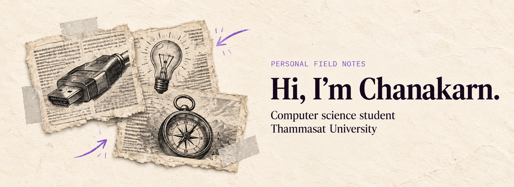

<picture>
  <source media="(prefers-color-scheme: dark)" srcset="./assets/banner-dark.png">
  
</picture>

I’m looking for an internship where I can build software with a team.

## Projects

<table>
  <tr>
    <td width="50%" valign="top"><strong><a href="https://github.com/Micosz/Cs361-Group1-Project7">CSTU Hub</a></strong> A team web application for the Thammasat CS community.</td>
    <td width="50%" valign="top"><strong><a href="https://github.com/Micosz/course-timetabling-lab">Course Timetabling Lab</a></strong> Explore how room and time constraints shape a course schedule.</td>
  </tr>
  <tr>
    <td valign="top"><strong><a href="https://github.com/Micosz/Map_Navigation">Indoor Map Navigation</a></strong> Find a room and follow directions across floors.</td>
    <td valign="top"><strong><a href="https://github.com/Micosz/company-news-nlp-workbench">Company News NLP Workbench</a></strong> Compare news reports to study whether they describe the same event.</td>
  </tr>
</table>

## Skills

- **Development** · Python, JavaScript, HTML, CSS
- **Tools** · Git, GitHub Actions
- **Cloud** · AWS Lambda, API Gateway, DynamoDB
- **NLP** · TF-IDF, cosine similarity
